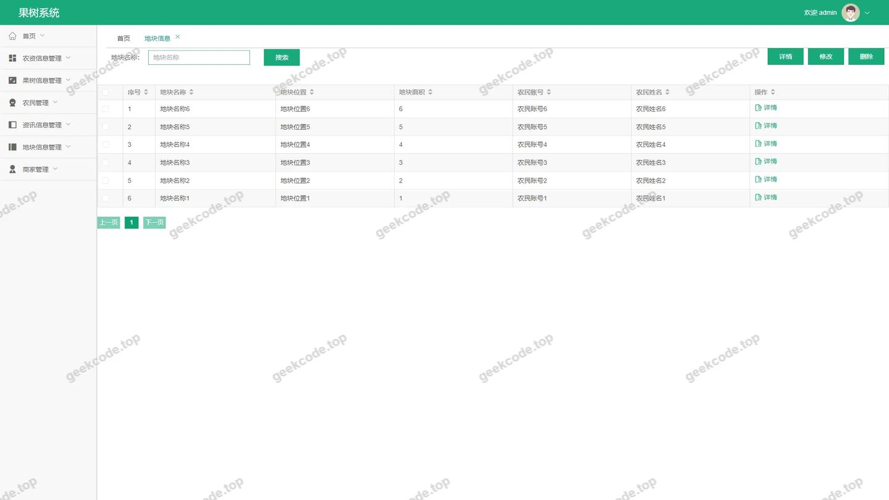
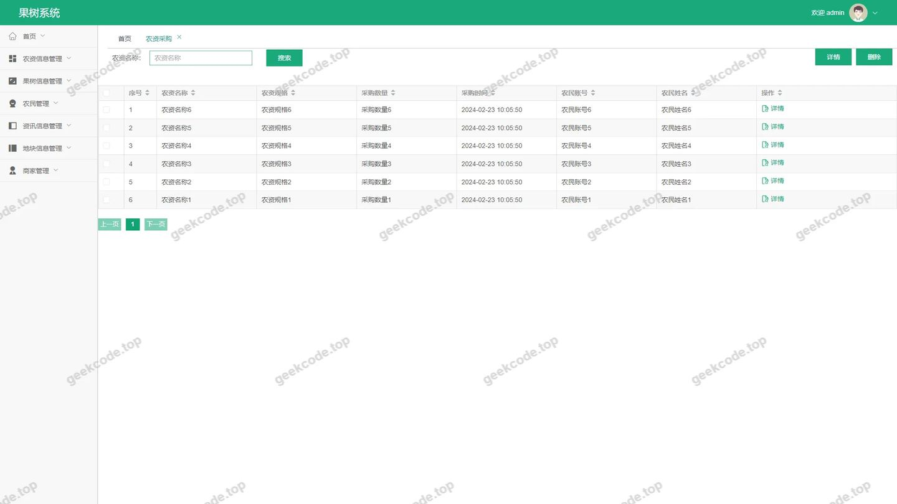
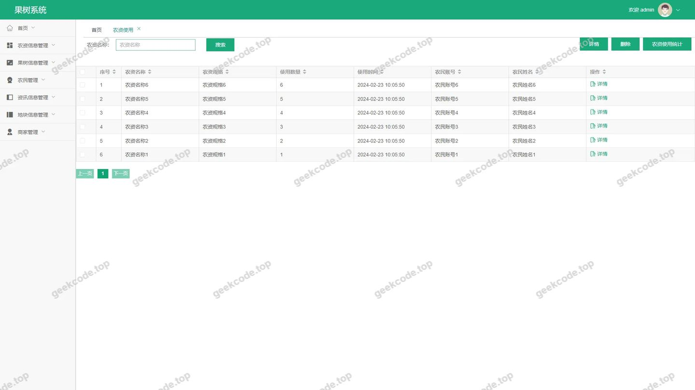
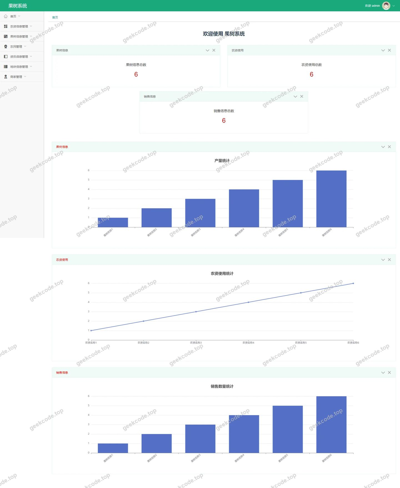
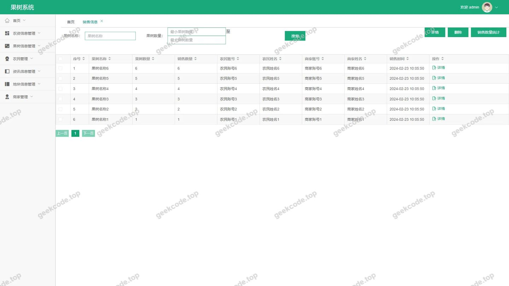
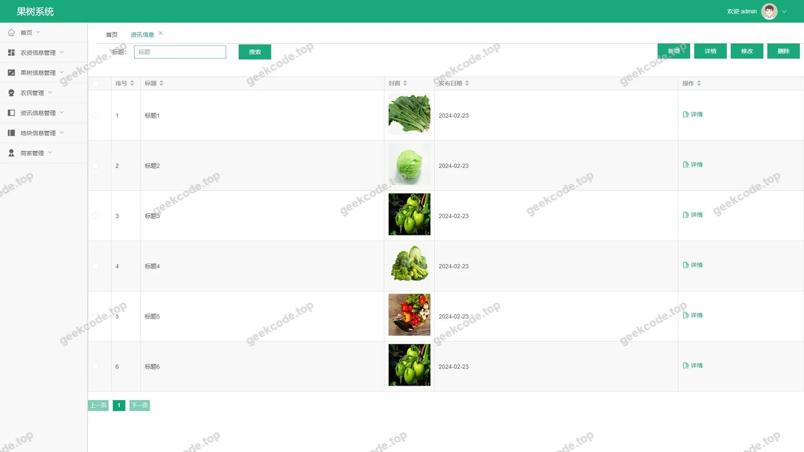

# [springboot]果树系统

> 🎓 **计算机毕业设计 · [springboot]果树系统**
>
> 本仓库只放**项目介绍 + 运行截图**（截图是站点带水印的原图，存在仓库 `images/` 里）。
>
> 👉 **完整可运行源码 / 数据库脚本 / 部署文档：[点我获取](https://geekcode.top/archives/springboot-%E6%9E%9C%E6%A0%91%E7%B3%BB%E7%BB%9F?utm_source=github)**
>
> 💬 咨询微信：**ir9372**　|　🌐 更多项目：[极客代码 geekcode.top](https://geekcode.top/?utm_source=github)
>
> 📌 项目详情页：<https://geekcode.top/archives/springboot-%E6%9E%9C%E6%A0%91%E7%B3%BB%E7%BB%9F?utm_source=github>

<table><td width="230" align="center"> <b>扫码加微信 ir9372</b></td><td valign="middle">📦 源码 = 项目介绍 + 全部运行截图 + 数据库 + 部署文档 👉 点上方任意截图，直接跳到 <b>极客代码 geekcode.top</b> 详情页</td></table>

---

<h1>[springboot]果树系统</h1>
<h2>项目概述</h2>

本项目为“果树系统”，旨在构建一个集农业生产管理与商业流通于一体的综合性平台。系统核心聚焦于果树种植、农资管理及农产品销售的全流程数字化管理。主要功能涵盖农户与商家的注册认证、地块信息管理、农资采购与使用记录、果树及农资基础数据维护，以及资讯发布与销售信息展示。适用人群包括从事果树种植的农户、提供农资或收购服务的商家以及系统管理员。技术架构采用前后端分离模式，后端基于 Spring Boot 框架，结合 MyBatis-Plus 进行高效数据持久化操作，并使用 Apache Shiro 实现细粒度的权限控制，确保多角色用户的数据安全与业务隔离。

<h2>技术架构</h2>

本系统采用 Vue 集成式的前后端分离架构。前端负责用户交互与视图渲染，后端提供 RESTful API 接口服务。

<strong>后端技术栈：</strong>

<ul>
<li><strong>核心框架</strong>：Spring Boot (spring-boot-starter-web)，用于快速构建独立运行的 Java 应用程序，简化配置与开发流程。</li>
<li><strong>ORM 框架</strong>：MyBatis-Plus (mybatis-plus, mybatisplus-spring-boot-starter)，在 MyBatis 基础上增强 CRUD 操作能力，提升数据库访问效率。</li>
<li><strong>安全框架</strong>：Apache Shiro (shiro-spring)，负责身份认证、授权管理、会话管理和加密解密，保障系统安全性。</li>
<li><strong>数据存储</strong>：MySQL (mysql-connector-java)，作为关系型数据库存储业务数据。</li>
<li><strong>其他依赖</strong>：commons-lang3（工具类）、validation-api（参数校验）、protobuf-java（序列化支持）。</li>
</ul>

<strong>数据库设计要点：</strong>
数据库围绕核心业务实体进行建模，主要包含以下关键表结构逻辑：

<ol>
<li><strong>用户域</strong>：区分“农户” (<code>nongmin</code>) 和“商家” (<code>shangjia</code>) 两类主体，分别拥有独立的注册 (<code>Register</code>) 与信息维护模块。</li>
<li><strong>资源域</strong>：包含“果树信息” (<code>guoshuxinxi</code>)、“农资信息” (<code>nongzixinxi</code>) 和“地块信息” (<code>dikuaixinxi</code>)，构成农业生产的基础数据字典。</li>
<li><strong>交易与行为域</strong>：“农资采购” (<code>nongzicaigou</code>) 记录购买行为，“农资使用” (<code>nongzishiyong</code>) 追踪田间应用情况，“销售信息” (<code>xiaoshouxinxi</code>) 管理产品流通数据。</li>
<li><strong>内容域</strong>：“资讯信息” (<code>zixunxinxi</code>) 用于发布行业动态或技术指导。</li>
</ol>
<h2>功能模块</h2>

根据后台路由配置及截图所示，系统功能主要划分为以下模块，所有功能均通过后台管理界面进行操作与维护：

<h3>1. 用户中心模块</h3>
<ul>
<li><strong>农户中心 (<code>/nongminCenter</code>)</strong>：农户登录后的专属工作台，可查看和管理个人相关信息。</li>
<li><strong>商家中心 (<code>/shangjiaCenter</code>)</strong>：商家登录后的专属工作台，提供针对商家角色的功能入口。</li>
<li><strong>农户注册 (<code>/nongminRegister</code>)</strong>：新农户账号的创建入口，收集基础身份信息。</li>
<li><strong>商家注册 (<code>/shangjiaRegister</code>)</strong>：新商家账号的创建入口，收集商户资质信息。</li>
</ul>
<h3>2. 基础信息管理模块</h3>
<ul>
<li><strong>果树信息 (<code>/guoshuxinxi</code>)</strong>：管理果树品种、生长特性等基础档案。</li>
<li><strong>农资信息 (<code>/nongzixinxi</code>)</strong>：维护农药、化肥等农业生产资料的标准数据。</li>
<li><strong>地块信息 (<code>/dikuaixinxi</code>)</strong>：登记农田地块的位置、面积、归属等地理属性。</li>
<li><strong>农户管理 (<code>/nongmin</code>)</strong>：管理员对所有农户账户进行审核、查询与维护。</li>
<li><strong>商家管理 (<code>/shangjia</code>)</strong>：管理员对所有商家账户进行审核、查询与维护。</li>
</ul>
<h3>3. 业务流程管理模块</h3>
<ul>
<li><strong>农资采购 (<code>/nongzicaigou</code>)</strong>：记录农户向商家购买农资的交易明细，包括数量、金额及时间。</li>
<li><strong>农资使用 (<code>/nongzishiyong</code>)</strong>：跟踪农资在具体地块上的施用记录，关联果树生长阶段。</li>
<li><strong>销售信息 (<code>/xiaoshouxinxi</code>)</strong>：管理果树产品的销售订单、渠道及流向数据。</li>
</ul>
<h3>4. 信息发布模块</h3>
<ul>
<li><strong>资讯信息 (<code>/zixunxinxi</code>)</strong>：发布农业政策、种植技术、市场行情等图文资讯。</li>
</ul>
<h2>用户角色与权限</h2>

系统基于 Shiro 框架实现了严格的角色隔离与权限控制，主要包含以下三类角色：

<table>
<thead>
<tr>
<th align="left">角色</th>
<th align="left">描述</th>
<th align="left">可访问功能模块</th>
</tr>
</thead>
<tbody><tr>
<td align="left"><strong>管理员 (Admin)</strong></td>
<td align="left">系统超级用户，负责全局数据监控与基础配置。</td>
<td align="left">- 登录页- 首页概览- 农户管理 (<code>/nongmin</code>)- 商家管理 (<code>/shangjia</code>)- 果树信息 (<code>/guoshuxinxi</code>)- 农资信息 (<code>/nongzixinxi</code>)- 地块信息 (<code>/dikuaixinxi</code>)- 农资采购 (<code>/nongzicaigou</code>)- 农资使用 (<code>/nongzishiyong</code>)- 销售信息 (<code>/xiaoshouxinxi</code>)- 资讯信息 (<code>/zixunxinxi</code>)- 农户注册审核 (<code>/nongminRegister</code>)- 商家注册审核 (<code>/shangjiaRegister</code>)</td>
</tr>
<tr>
<td align="left"><strong>农户 (Nongmin)</strong></td>
<td align="left">生产端用户，专注于自家果园的管理与物资获取。</td>
<td align="left">- 农户中心 (<code>/nongminCenter</code>)- 农户注册 (<code>/nongminRegister</code>)- <em>注：具体可见的数据范围受限于其所属地块与账号ID，通常仅查看自身相关的采购、使用及销售记录。</em></td>
</tr>
<tr>
<td align="left"><strong>商家 (Shangjia)</strong></td>
<td align="left">供应/收购端用户，专注于农资销售与果品收购。</td>
<td align="left">- 商家中心 (<code>/shangjiaCenter</code>)- 商家注册 (<code>/shangjiaRegister</code>)- <em>注：具体可见的数据范围受限于其店铺ID，通常仅处理发给该商家的采购请求或该商家的销售记录。</em></td>
</tr>
</tbody></table>
<h2>项目特色与创新点</h2>
<ol>
<li><strong>全链路闭环管理</strong>：系统打通了从“农资采购”到“农资使用”，再到“果树生长”与最终“产品销售”的完整农业产业链条。通过 <code>nongzicaigou</code> 和 <code>nongzishiyong</code> 模块的联动，实现了投入品溯源与产出物管理的数字化闭环。</li>
<li><strong>双主体差异化服务</strong>：明确区分“农户”与“商家”两大核心用户群体，通过 <code>/nongminCenter</code> 和 <code>/shangjiaCenter</code> 提供定制化的工作台，避免了通用管理系统中角色混淆的问题，提升了用户体验的专业度。</li>
<li><strong>标准化数据支撑</strong>：引入 <code>guoshuxinxi</code>、<code>nongzixinxi</code> 和 <code>dikuaixinxi</code> 作为基础数据层，确保了业务操作中的数据一致性。例如，农资使用记录必须关联标准农资信息和特定地块，减少了人工录入错误。</li>
<li><strong>轻量级安全架构</strong>：采用 Shiro 而非更重的 Spring Security，在保证 RBAC（基于角色的访问控制）安全性的同时，降低了系统复杂度，适合中小型农业信息化项目的快速部署与维护。</li>
</ol>
<h2>部署环境</h2>

为确保系统正常运行，需准备以下软件环境：

<ul>
<li><strong>操作系统</strong>：Windows 10/11 或 Linux (CentOS 7+, Ubuntu 20.04+)</li>
<li><strong>Java 运行环境</strong>：JDK 1.8 或以上版本</li>
<li><strong>数据库</strong>：MySQL 5.7 或 MySQL 8.0</li>
<li><strong>构建工具</strong>：Maven 3.6+</li>
<li><strong>前端环境</strong>：Node.js 14.x 或更高版本（用于编译 Vue 前端代码）</li>
<li><strong>Web 服务器</strong>：内置 Tomcat (Spring Boot 自带) 或 Nginx (用于静态资源托管及反向代理)</li>
</ul>
<h2>五、技术特性</h2>
<ul>
<li>前后端集成部署，前端资源打包至后端 static 目录</li>
<li>使用 MyBatis-Plus 简化数据访问层开发</li>
<li>集成 Shiro 权限框架实现角色权限控制</li>
</ul>
<h2>六、功能模块截图</h2>
<h3>后台管理端</h3>
<h4>后台-地块信息</h4>

<h4>后台-登录页</h4>

<h4>后台-农资采购</h4>

<h4>后台-农资使用</h4>

<h4>后台-农资信息</h4>

<h4>页面-首页</h4>

<h4>后台-销售信息</h4>

<h4>后台-资讯信息</h4>

---

## 获取完整源码

| 项目 | 说明 |
| --- | --- |
| 项目名 | [springboot]果树系统 |
| 运行截图 | 本文 8 张（站点带水印原图，仓库 `images/` 目录） |
| 完整源码 | [https://geekcode.top/archives/springboot-%E6%9E%9C%E6%A0%91%E7%B3%BB%E7%BB%9F?utm_source=github](https://geekcode.top/archives/springboot-%E6%9E%9C%E6%A0%91%E7%B3%BB%E7%BB%9F?utm_source=github) |
| 咨询微信 | **ir9372**（备注：jingpin-yuanma） |
| 更多项目 | [极客代码 geekcode.top](https://geekcode.top/?utm_source=github) |

> 需要源码、部署、改配置、跑不起来等问题，加微信 ir9372 沟通，说明项目名即可。
